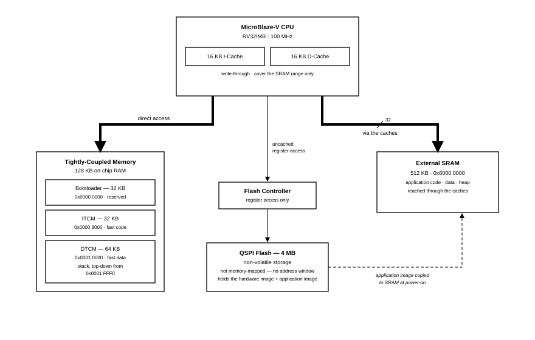
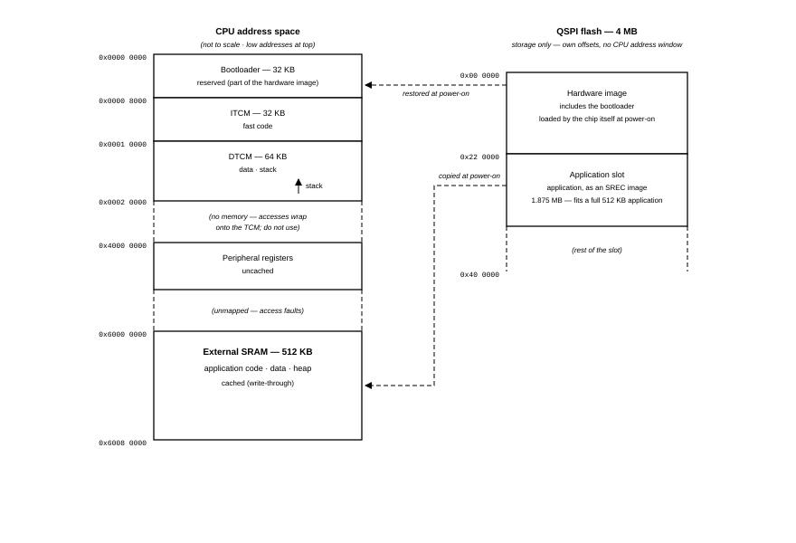
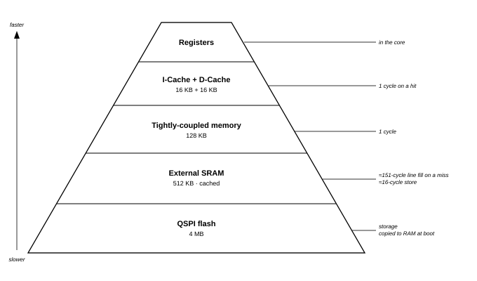

# Cmod A7-35T Memory Specification

**Platform:** Cmod A7-35T RISC-V MCU  
**Scope:** memory hierarchy, address map, caches, measured access latencies, placement guidance  

The MCU provides three types of memory: single-cycle tightly-coupled memory,
cached external SRAM, and QSPI flash storage. Ordinary code and data reside
in the SRAM; latency-critical code and data may be placed in the
tightly-coupled memory.

---

## 1. Memory Hierarchy Overview

| Memory | Size | Role |
|---|---|---|
| Tightly-coupled memory | 128 KB | Interrupt handlers, stack, frequently accessed data |
| I-Cache + D-Cache | 16 KB + 16 KB | Transparent acceleration of SRAM |
| External SRAM | 512 KB | Application code, data, heap |
| QSPI flash | 4 MB | Non-volatile: application + hardware image |

## 2. Memory Map

| Address range | Size | Region | Access |
|---|---|---|---|
| `0x0000_0000` – `0x0000_7FFF` | 32 KB | Bootloader (reserved) | uncached |
| `0x0000_8000` – `0x0000_FFFF` | 32 KB | ITCM — application code | uncached |
| `0x0001_0000` – `0x0001_FFFF` | 64 KB | DTCM — data; stack grows down from `0x0001_FFF0` | uncached |
| `0x4000_0000` – `0x40FF_FFFF` | — | Peripheral registers | uncached |
| `0x6000_0000` – `0x6007_FFFF` | 512 KB | External SRAM — application code / data / heap | cached |

> **Note:** Unused addresses in the `0x4000_0000` – `0x7FFF_FFFF` range return a
> bus error. Elsewhere the tightly-coupled memory is not decoded fully: an
> access to an address outside the listed regions, such as `0x0002_0000`,
> wraps around onto the 128 KB tightly-coupled memory. A stray pointer there
> therefore fails silently and can overwrite the bootloader, ITCM code, or the
> stack.

## 3. Caches

| Item | Value |
|---|---|
| Instruction cache | 16 KB, 32-byte lines |
| Data cache | 16 KB, 32-byte lines |
| Write policy | write-through — every store is forwarded to SRAM |
| Cached range | exactly the SRAM: `0x6000_0000` – `0x6007_FFFF` |

Only the SRAM range is cached. The tightly-coupled memories are already
fast enough, and peripheral registers must observe every access, so neither
is ever cached. The caches are always on for the cached range and require no
software management.

The write-through policy has two practical consequences:

- Reads benefit fully from the cache: a hit has the same latency as a
  TCM access.
- Writes always incur the SRAM latency, even on a cache hit. Frequently
  written data (counters, buffers filled in interrupt handlers) should
  therefore be placed in the DTCM.

## 4. Measured Access Latencies

The figures below were measured on the board at 100 MHz by the `mem_bench`
example: optimized (`-O2`) read and write loops timed with a hardware cycle
counter, with the loop's own overhead (≈7 cycles per word) subtracted; the
cache-miss figure was taken immediately after invalidating the data cache.
Each value is the latency of a single access.

| Access | Cycles | Notes |
|---|---|---|
| TCM read | 1 | single-cycle; identical every time |
| SRAM read, cache **hit** | 1 | a hit matches the TCM |
| SRAM read, cache **miss** | ≈151 | fetches one 32-byte line (≈19 cycles per word) |
| SRAM write (write-through) | ≈16 | per store; the store waits for SRAM |

## 5. Memory Placement Guidance

The linker script `mcu/cmod_mcu.ld` assigns every section to a memory, and
the device header `mcu/cmod_mcu.h` provides the `ITCM_FUNC` and `DTCM_DATA`
attributes that move individual functions and variables into the
tightly-coupled memories.

| What | Put it in | How |
|---|---|---|
| Interrupt handlers, timing-critical loops | ITCM | `ITCM_FUNC` |
| Frequently-written data, buffers, the `XIntc` driver instance | DTCM | `DTCM_DATA` |
| Stack | DTCM | automatic: all DTCM after the `DTCM_DATA` variables |
| Everything else — code, constants, data | SRAM | default |
| Heap | SRAM | automatic: all SRAM after the program |
| Firmware image | QSPI flash | see the Standalone Boot Mode guide |

As a general rule, place code and data in SRAM by default and move them to
the TCMs when predictable timing is required. In the tightly-coupled
memories the worst-case latency equals the best-case latency.

Code in the ITCM keeps that property only while everything it calls is in
the ITCM as well. At `-O0` the board-support package's `Xil_In32()` and
`Xil_Out32()` are real function calls into SRAM, so ITCM code accesses
registers with `REG32()` from `cmod_mcu.h`.

### 5.1 Interrupt Latency

The trap entry and the interrupt controller's dispatch code always run from
the ITCM, and the tables they read live in the DTCM. What remains to place
is the handler itself and the `XIntc` driver instance:

| Handler placement | Warm cache | Cold cache |
|---|---|---|
| `ITCM_FUNC` handler, `XIntc` instance in DTCM | 187 | 187 |
| `ITCM_FUNC` handler, `XIntc` instance in SRAM | 187 | 227 |
| Handler in SRAM | 187 | 591 |
| `ITCM_FUNC` handler calling `Xil_In32()` at `-O0` | 199 | 348 |

Cycles at 100 MHz from a timer event to the handler's first register read,
measured on the board: `timer_2` raises the interrupt as it reloads, and the
handler's first action reads the counter. "Cold" means both caches were
invalidated before every interrupt, the worst case. Each value is the median
of 256 interrupts; no run varied by more than 2 cycles. With the handler in
the ITCM and the instance in the DTCM, an interrupt reaches the handler in
1.87 µs whatever the cache state.
